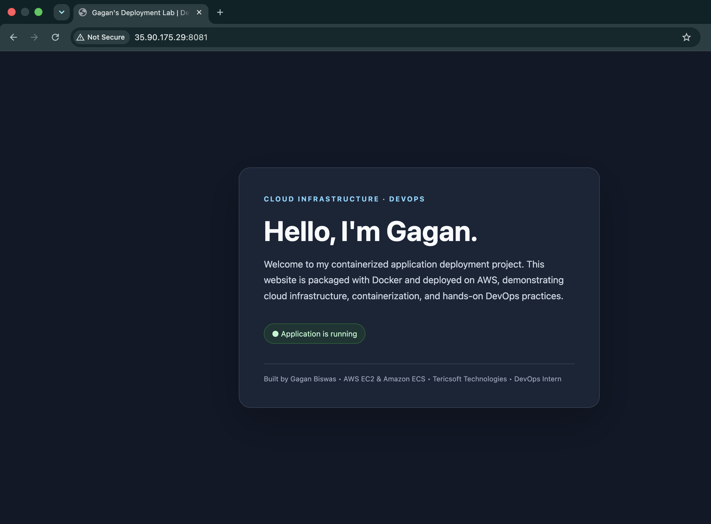
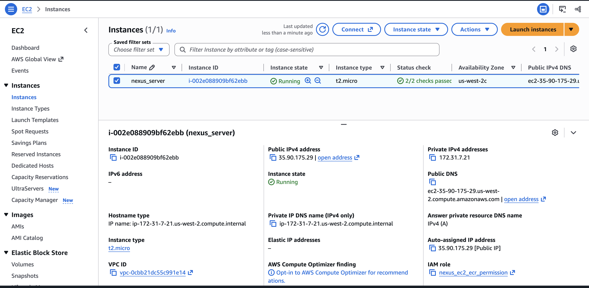
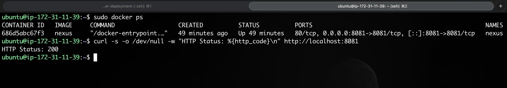
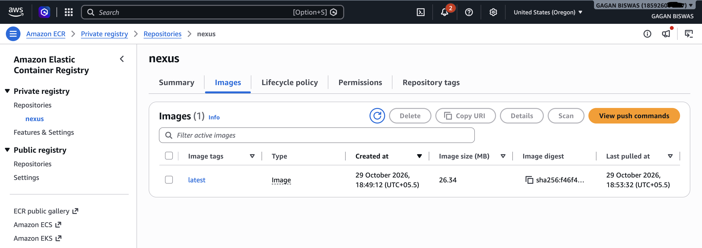
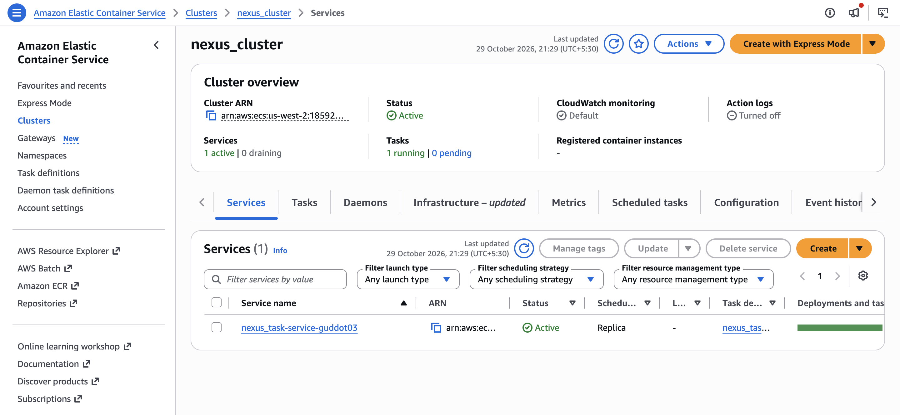
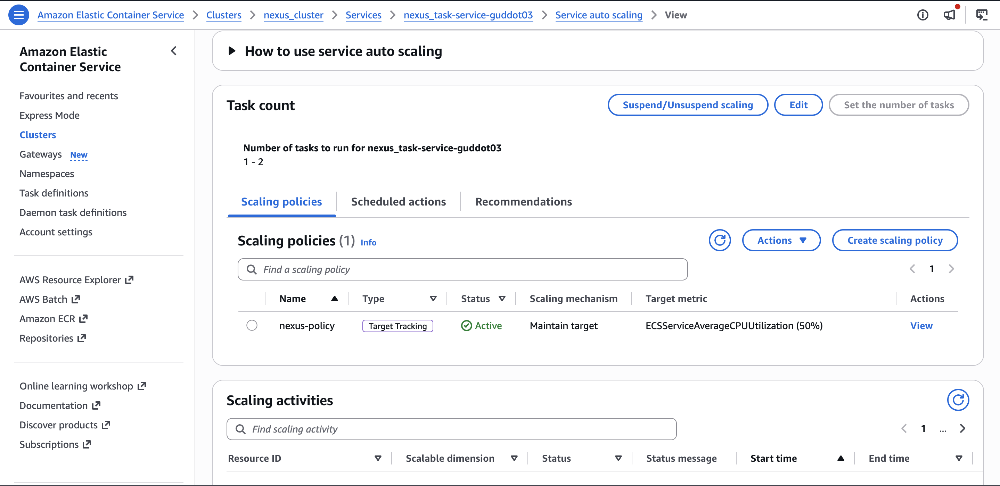

# Nexus — Tericsoft DevOps Assessment

A static web application packaged with Docker and deployed on AWS EC2,
with an additional deployment to Amazon ECS.

## Technology Stack

- HTML and CSS
- Nginx
- Docker
- Amazon EC2
- Amazon ECR
- Amazon ECS with AWS Fargate
- Git and GitHub

### Why I Chose This Instance Size
Explain why t2.micro is sufficient for your lightweight
Nginx and Docker application and helps keep costs low.

## Run Locally

Build the Docker image:

    docker build -t nexus:1.0 .

Run the container:

    docker run --name cloud-hello -d -p 8081:8081 nexus:1.0

Open http://localhost:8081 in your browser.

Stop and remove the local container:

    docker rm -f cloud-hello
 
 ## Deployment Overview

The Nexus application was containerized using Docker and deployed on Amazon EC2. An additional deployment using Amazon ECS with AWS Fargate was explored as part of the assessment.

## Infrastructure and Instance Selection

### Amazon EC2 Configuration

| Component | Configuration |
|---|---|
| Cloud Provider | Amazon Web Services (AWS) |
| Region | US West (Oregon) - `us-west-2` |
| Operating System | Ubuntu Server 24.04 LTS |
| Instance Type | `t2.micro` |
| CPU | 1 vCPU |
| Memory | 1 GiB RAM |
| Storage | EBS volume size as configured in AWS |
| Application Port | `8081` |

### Why I Chose This Instance Size

I selected the `t2.micro` instance because the application is a lightweight static website served by Nginx inside a Docker container. It does not require a database or other resource-intensive services, making a small instance suitable for demonstrating containerization and public web access.

This choice helps keep infrastructure costs relatively low while meeting the assessment requirements. The instance can be upgraded if the workload requires additional CPU, memory, or capacity.

### Application Architecture

The deployment uses the following AWS services and technologies:

- **Amazon EC2:** Hosts the Dockerized application.
- **Docker:** Packages the application and its Nginx web server into a container.
- **Amazon ECR:** Stores the container image for use with ECS.
- **Amazon ECS:** Manages the containerized application service.
- **AWS Fargate:** Provides serverless compute capacity for ECS tasks.
- **ECS Service Auto Scaling:** Adjusts the desired number of running tasks based on CPU utilization.
- **Amazon CloudWatch:** Provides metrics used by the target-tracking scaling policy.
- **GitHub:** Stores the application source code and deployment documentation.

## Deployment Screenshots

The following screenshots provide a visual overview of the infrastructure, application, container image, and ECS deployment.

### 1. Application Running on Amazon EC2

The application is accessible through the EC2 public IP address on port `8081`.

### 2. EC2 Instance Configuration

The instance details show the selected compute configuration and operating system.

### 3. Docker Container and HTTP Verification

The running container, port mapping, and HTTP response verify that the application is responding successfully.

### 4. Amazon ECR Container Image

The container image stored in Amazon Elastic Container Registry for use in the ECS deployment.

### 5. Amazon ECS Service

The ECS service and task status show the deployment configuration for the containerized application running on AWS Fargate.

### 6. ECS Service Auto Scaling

ECS Service Auto Scaling is configured with a target-tracking policy based on average CPU utilization. The policy allows the service to adjust the number of running tasks according to workload demand.

## Auto Scaling Configuration

The following settings were used for the ECS service scaling policy.

| Setting | Value |
|---|---|
| Scaling Policy | Target Tracking |
| Metric | ECS Service Average CPU Utilization |
| CPU Target | 50% |
| Minimum Tasks | 1 |
| Maximum Tasks | 2 |
| Scale-Out Cooldown | 60 seconds |
| Scale-In Cooldown | 120 seconds |

### How Auto Scaling Works

When CPU utilization increases above the target, ECS Service Auto Scaling can increase the desired task count, up to the configured maximum. When demand decreases, the service can scale in toward the minimum task count.

The scale-out and scale-in cooldown settings help control how frequently subsequent scaling adjustments occur. This configuration demonstrates a basic approach to managing application capacity according to workload demand.

## Loom Walkthrough

The Loom recording demonstrates the deployment process, infrastructure choices, application verification, ECS configuration, and Auto Scaling setup.

**Video Walkthrough:** [Watch the Nexus DevOps Assessment](https://www.loom.com/share/a6605a3b34e1425d85b9e1e857597caa)

## Documentation Note

The screenshots in this README provide a quick visual reference to the deployment and configuration. They were added to the repository after the initial walkthrough to make the implementation easier to review.

## Cost Considerations

AWS resources may incur charges while running. The EC2 instance, EBS volume, container registry storage, and Fargate tasks should be monitored to avoid unnecessary costs.

Unused resources should be stopped or deleted when they are no longer required, taking care not to remove resources that are still needed.

## Key Learnings

- Containerizing a static web application using Docker and Nginx.
- Provisioning and configuring an Ubuntu-based EC2 instance.
- Configuring network access and exposing a web application on a custom port.
- Managing container images with Amazon ECR.
- Deploying and managing containers using Amazon ECS and AWS Fargate.
- Configuring ECS Service Auto Scaling with a CPU target-tracking policy.
- Documenting deployment steps, verification results, and infrastructure decisions.

